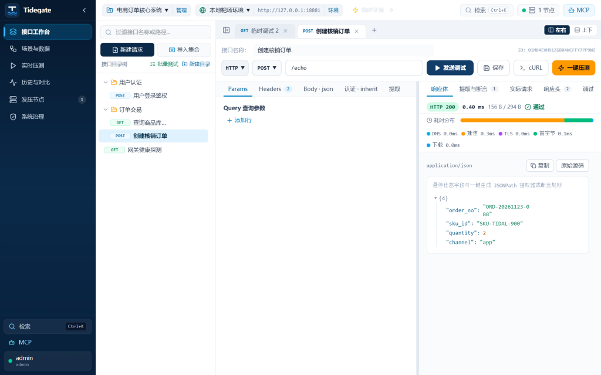
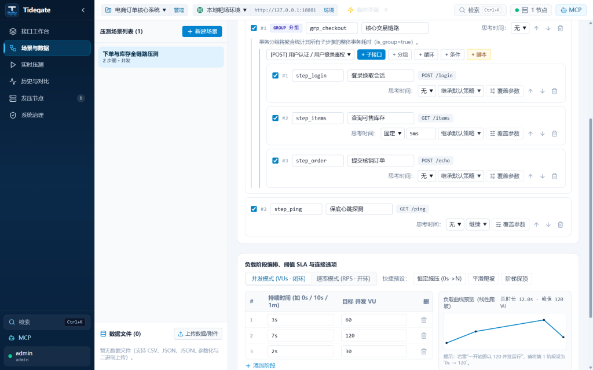
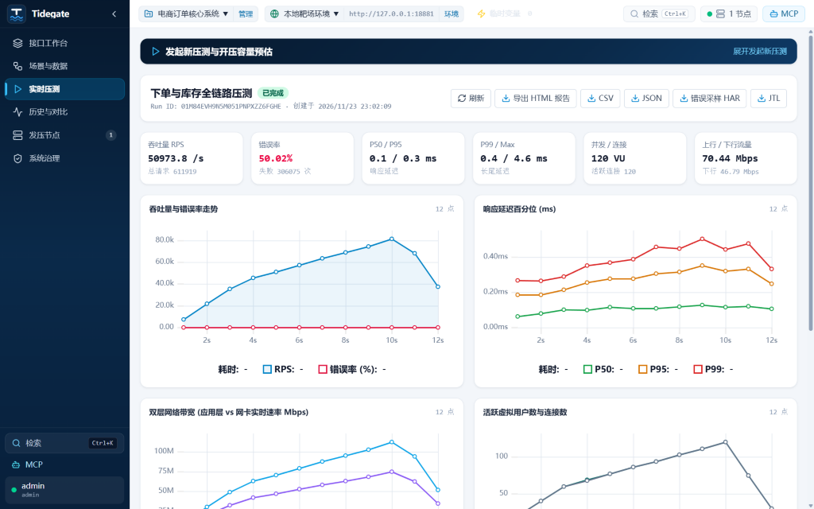

<p align="center">
  <picture>
    <source media="(prefers-color-scheme: dark)" srcset="assets/logo-wordmark-dark.svg">
    
  </picture>
</p>

<p align="center">本地优先的 API 调试、功能回归与分布式压测控制台（内置安全 MCP 2.0 网关）</p>

<p align="center">
  <a href="docs/install.md"><strong>安装与环境变量配置</strong></a> ·
  <a href="docs/user-guide.md"><strong>完整使用教程</strong></a> ·
  <a href="docs/product-plan.md"><strong>产品架构白皮书</strong></a> ·
  <a href="#产品界面预览"><strong>界面预览</strong></a> ·
  <a href="#性能实测对比-vs-k6"><strong>性能对比（vs k6）</strong></a>
</p>

---

Tidegate 把接口管理、多协议调试、场景编排与高并发分布式压测合并进单一原生二进制：接口定义以 YAML 落盘，调试、批量回归与压测直接共用同一套定义；控制台与发压引擎分进程隔离，发压机饱和时自动捕获硬件瓶颈告警；并通过纯 Go MCP 2.0 服务网关向 AI 助手开放受 RBAC、项目 ACL、Scope 与压测上限保护的协作能力。

## 产品界面预览

| 接口工作台与多协议调试 | 场景编排与控制流 |
| :---: | :---: |
|  |  |

| 实时压测大盘与硬件遥测 | 系统治理与 MCP 客户端接入 |
| :---: | :---: |
|  |  |

---

## 性能实测对比 vs k6

以下数据在本机启用 `--split-cpu`（被测服务与发压端各固定隔离一半逻辑核）直接对比实测获得，详见 [bench/harness](bench/harness/main.go)：

- **硬件与环境**：Intel(R) Core(TM) i9-14900KF（32 逻辑处理器），64 GB RAM，Windows 10.0.26100，`go1.26.0`
- **对比对象**：`tidegate-fast`、`tidegate-std` vs `k6 v2.3.0 (commit/e088784614, go1.26.8, windows/amd64)`
- **评测口径**：每组稳态保持 `15s`；超过 200 VUs 先以 200 VUs/s 爬坡，Open-loop 先经过 `2s` 预热；全程值含爬坡/预热，“稳态”列仅统计稳定期整秒。

| 测试场景 | 对象 | 并发 / 目标 | 稳态 RPS | 全程 RPS | P50 (ms) | P99 (ms) | 稳态 P99 (ms) | 错误数 | 峰值工作集内存 | 发压 CPU（核） |
|---|---|---:|---:|---:|---:|---:|---:|---:|---:|---:|
| **HTTP/1.1** (`100 VUs`) | `tidegate-fast` | 100 VUs | **265,516** | **265,490** | **0.338** | **1.395** | **1.187** | 0 | **37.3 MB** | 15.23 |
| **HTTP/1.1** (`100 VUs`) | `tidegate-std` | 100 VUs | 199,851 | 199,822 | 0.354 | 3.681 | 3.565 | 0 | 45.0 MB | 14.22 |
| **HTTP/1.1** (`100 VUs`) | `k6 v2.3.0` | 100 VUs | - | 171,110 | 0.522 | 1.842 | - | 0 | 598.9 MB | 14.96 |
| **HTTP/1.1** (`1000 VUs`) | `tidegate-fast` | 1,000 VUs | **211,029** | **184,923** | **3.649** | 28.991 | 28.399 | 0 | **58.2 MB** | 15.42 |
| **HTTP/1.1** (`1000 VUs`) | `tidegate-std` | 1,000 VUs | 210,823 | 172,267 | 4.065 | **21.679** | **11.111** | 0 | 107.4 MB | 15.18 |
| **HTTP/1.1** (`1000 VUs`) | `k6 v2.3.0` | 1,000 VUs | - | 98,476 | 5.324 | 34.906 | - | 0 | 750.9 MB | 15.17 |
| **HTTPS TLS** (`100 VUs`) | `tidegate-fast` | 100 VUs | **207,752** | **207,614** | **0.332** | 6.167 | **1.253** | 0 | **44.5 MB** | 15.34 |
| **HTTPS TLS** (`100 VUs`) | `tidegate-std` | 100 VUs | 152,585 | 152,473 | 0.353 | 4.459 | 4.703 | 0 | 48.9 MB | 14.63 |
| **HTTPS TLS** (`100 VUs`) | `k6 v2.3.0` | 100 VUs | - | 158,350 | 0.519 | **3.677** | - | 0 | 598.8 MB | 15.06 |
| **Open-loop 50k RPS** | `tidegate-std` | 50,000/s | **49,999** | 47,028 | 0.434 | 0.909 | **0.837** | 341 | **93.5 MB** | **3.55** |
| **Open-loop 50k RPS** | `k6 v2.3.0` | 50,000/s | - | **47,045** | - | **0.515** | - | **0** | 254.1 MB | 5.14 |
| **Open-loop 50k RPS** | `tidegate-fast` | 50,000/s | 40,078 | 37,847 | 8.083 | 265.983 | 475.135 | 8633 | 88.2 MB | 12.18 |
| **5,000 VUs + 1s 思考** | `tidegate-fast` | 5,000 VUs | 4,407 | 3,299 | 0.135 | 2.010 | 0.955 | 0 | **184.4 MB** | 0.79 |
| **5,000 VUs + 1s 思考** | `tidegate-std` | 5,000 VUs | **4,998** | **3,491** | **0.125** | **0.785** | **0.368** | 0 | 353.8 MB | **0.52** |
| **5,000 VUs + 1s 思考** | `k6 v2.3.0` | 5,000 VUs | - | 3,413 | - | 0.788 | - | 0 | 1,256.2 MB | 0.72 |

- **闭环高并发与内存优势**：在 HTTP/1.1 1,000 VUs 压测中，`tidegate-fast` 全程与稳态吞吐均约为 `k6 v2.3.0` 的 **1.88× ~ 2.14×**，内存仅为 **1/13**（58.2 MB vs 750.9 MB）；5,000 VUs 思考时间下，`tidegate-fast` / `tidegate-std` 内存仅 **184.4 MB / 353.8 MB**，远低于 k6 的 **1,256.2 MB**。
- **开环速率（Open-loop）选型建议**：高到达率 `rate` 模式下，`--client std` 凭借平滑连接调度以 **3.55 核 CPU / 93.5 MB** 稳居 49,999 RPS；`fast` 客户端在 Windows 突发到达模式下易发生队列拥塞，建议在 Open-loop `rate` 压测时切换为 `--client std`。

<details>
<summary>复现命令（4 组标准对比测试）</summary>

```powershell
$env:CGO_ENABLED = "0"
go run ./bench/harness --duration 15s --vus 100,1000 --think-vus 0 --split-cpu --out bench/out/http
go run ./bench/harness --duration 15s --vus 100 --think-vus 0 --tls --split-cpu --out bench/out/tls
go run ./bench/harness --duration 15s --vus 1000 --think-vus 0 --mode rate --rate 50000 --split-cpu --out bench/out/rate
go run ./bench/harness --duration 15s --vus="" --think-vus 5000 --think 1s --split-cpu --out bench/out/think
```

</details>

---

## 核心功能矩阵

| 模块 | 能力范围 |
|---|---|
| 接口管理与 IDE 工作台 | 可折叠双轴导航、`Ctrl+K` 全局命令面板、左右/上下可拖拽分屏；`{{var}}` 四级变量补全与 AES-256-GCM 密钥保险箱；HTTP/1.1 & HTTP/2、WebSocket、gRPC（含 Server Reflection 与 `.proto` 自动发现/示例生成）、SSE；接口级前后置脚本、JSONPath/XPath/正则提取、JSON Schema 断言与目录批量回归 |
| 场景编排与韧性引擎 | 步骤参数覆写、`group`/`loop`/`if`/`weighted` 与纯 Go 受限 AST 脚本、`on_error`（`continue`/`abort_iteration`/`abort_vu`）失败策略、固定/均匀/正态思考时间、CSV/JSON/JSONL 数据切片与多场景 `Mix` |
| 双模压测与实时观测 | 闭环（VUs）与开环（Rate）双模型、在线调压、`max_dials_per_sec` 与空闲连接缓冲收缩、SLA 自动中止；`uPlot` 实时图表、HDR 直方图、时间热力图、硬件双层瓶颈告警、Prometheus 端点与 InfluxDB / Pushgateway 外推 |
| 企业治理与零信任集群 | RBAC（`admin`/`member`/`viewer`）与项目级私有 ACL、RFC 6238 TOTP 2FA、带 `scopes`/`project_ids` 绑定的 `tg_` 令牌、出站目标 SSRF 白名单与全量 `audit_logs`；ECDSA CA + 双向 mTLS 集群、Token 换签证书与吊销重平衡 |
| MCP 2.0 智能体接入 | Streamable HTTP (`POST /api/v1/mcp`) 与 CLI Stdio (`tidegate mcp`) 双传输、16 个工具、4 类只读 Resources、4 项专家 Prompts、Vault 零泄露脱敏与默认 200 VUs / 300s 护栏 |
| 导入导出生态 | 两步预览与非破坏性智能合并（OpenAPI 3.x / Swagger 2.0 / Postman v2.1 / Apifox / JMeter `.jmx` / HAR 1.2 / cURL / `.tidegate`）；导出 `.tidegate`、OpenAPI、Postman、k6 `.js`、HTML/CSV/JSON/JTL/JUnit XML/HAR |

---

## 快速开始

### 源码构建

需要 **Go 1.26+** 与 **Node.js 22+ / 24+**：

```bash
npm --prefix web ci && npm --prefix web run build
CGO_ENABLED=0 go build -trimpath -o tidegate ./cmd/tidegate
./tidegate
```

### Docker Compose 一键启动（支持环境变量改密与反代）

```bash
export TIDEGATE_ADMIN_PASSWORD="ChangeMe-StrongPassword!"
docker compose -f deploy/docker-compose.yml up -d --build
```

默认以自签名 HTTPS 监听 `https://localhost:8080/`（集群端口 `7443`，数据目录 `/data`）。若在 Docker / Kubernetes / 反代环境下部署，所有核心启动参数均支持 `TIDEGATE_*` 环境变量覆盖，并在重启时自动同步管理员密码：

| 常用环境变量 | 用途 |
|---|---|
| `TIDEGATE_ADMIN_USER` / `TIDEGATE_ADMIN_PASSWORD` / `TIDEGATE_ADMIN_PASSWORD_FILE` | 启动时自动创建或幂等同步管理员密码（密码变更时自动吊销旧会话） |
| `TIDEGATE_ADMIN_RESET_TOTP` | 设为 `true` 时启动清空目标管理员 2FA 绑定 |
| `TIDEGATE_PUBLIC_URL` / `TIDEGATE_TRUSTED_PROXIES` | 配置反代外网域名、CORS 放行及可信代理网段（解析真实客户端 IP 与 HTTPS 协议头） |
| `TIDEGATE_TLS_CERT` / `TIDEGATE_TLS_KEY` / `TIDEGATE_TLS_SELF_SIGNED` | 配置正式 PEM 证书或自签名证书 |
| `TIDEGATE_MASTER_KEY` / `TIDEGATE_CLUSTER_PUBLIC_ADDR` | 显式注入 AES-256-GCM 保险箱主密钥与集群对外公告地址 |

也随时支持通过命令行离线/单机重置密码（详见 [安装与环境变量文档](docs/install.md#4-管理员账号密码同步与-2fa-恢复)）：

```bash
./tidegate reset-password --data ./data --user admin --password "NewStrongPassword!"
```

### CLI 压测与功能回归（CI 门禁）

```bash
./tidegate testserver                                              # 启动内置多协议被测靶场（:18080）
./tidegate test --data ./data --folder "订单链路" --junit junit.xml  # 目录批量功能回归（失败返回退出码 3）
./tidegate run examples/ping.yaml --out res.json --html report.html # YAML 场景压测（违约返回退出码 3）
```

> 更多参数、Nginx/Caddy 反代模板、集群扩展与 MCP 客户端配置，请跳转：
> **[安装、环境变量与反代指南](docs/install.md)** · **[完整功能使用教程](docs/user-guide.md)**

---

## 许可

Copyright (c) 2026 whyy1

源码公开，但不是开源软件。本项目采用 [PolyForm Strict License 1.0.0](LICENSE)：

- 允许个人学习、研究和其他非商业用途的使用。
- 不允许商业使用，不允许分发，不允许修改后再发布。
- 需要商用或分发授权，请在 [Issues](https://github.com/whyy1/tidegate/issues) 里联系作者。

以 [LICENSE](LICENSE) 的英文原文为准。
