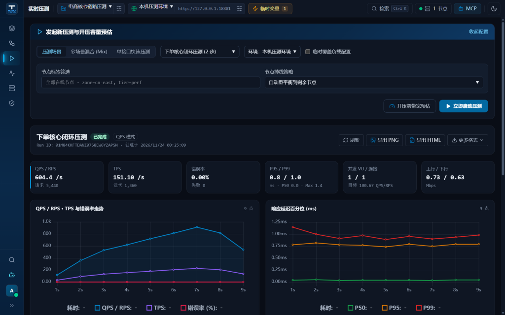
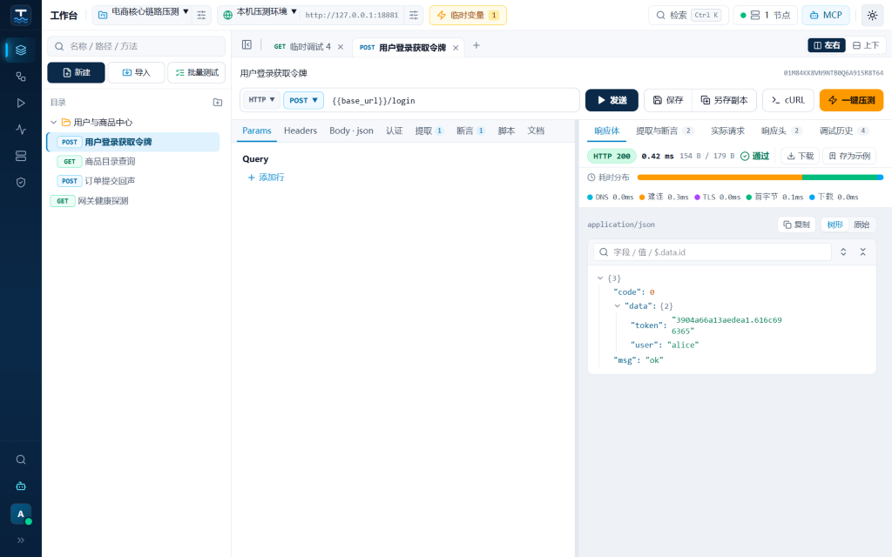
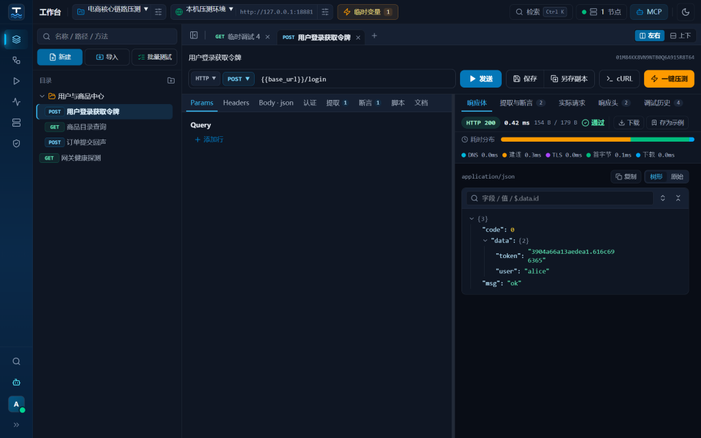
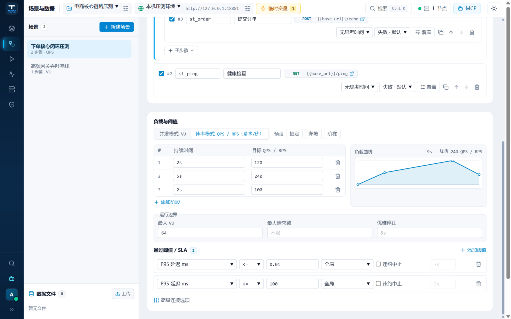
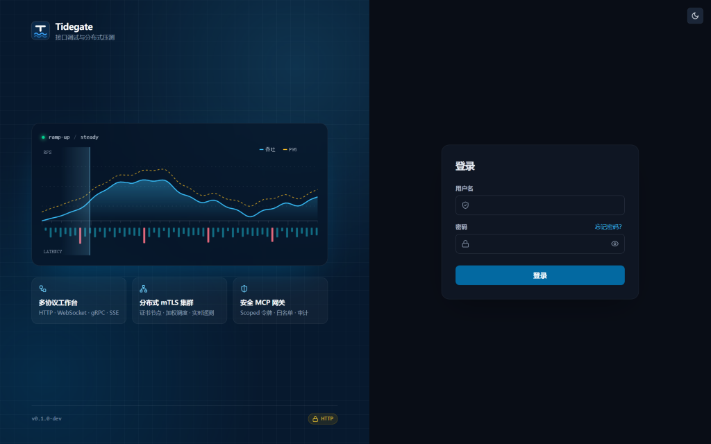
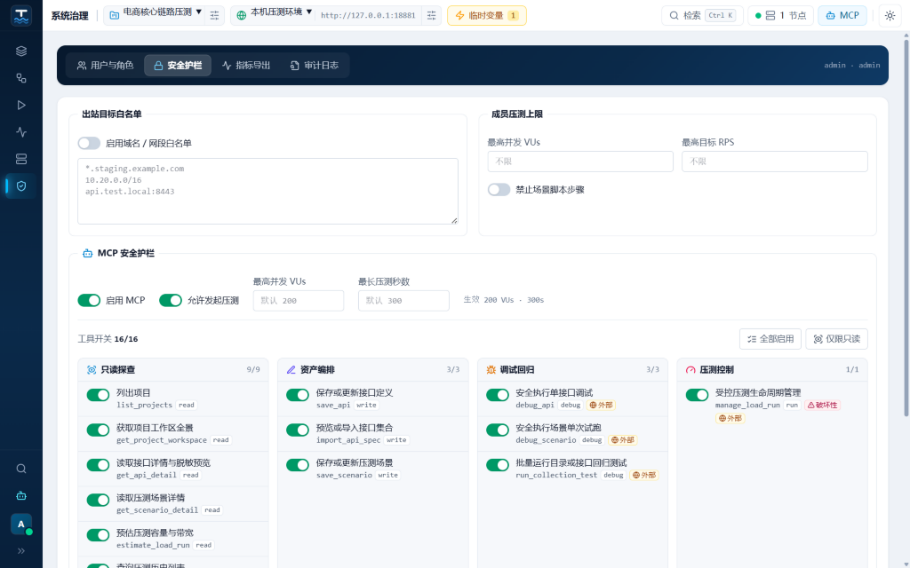
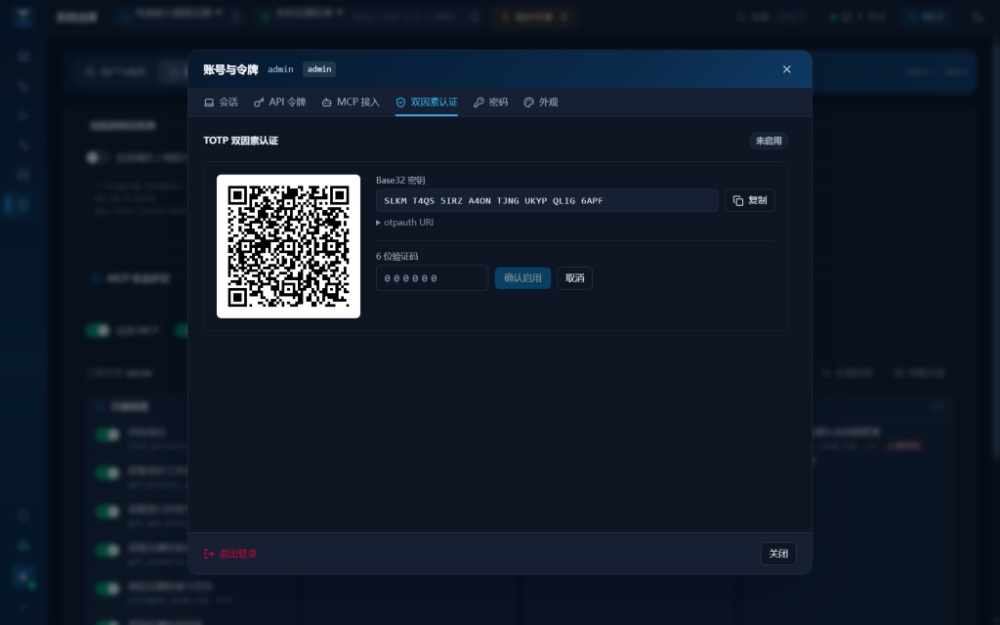

<p align="center">
  <picture>
    <source media="(prefers-color-scheme: dark)" srcset="assets/logo-wordmark-dark.svg">
    
  </picture>
</p>

<p align="center">本地优先的 API 调试与分布式高性能压测一体化平台（单二进制零依赖 + 原生双主题控制台 + 分布式 mTLS + MCP 2.0）</p>

<p align="center">
  <a href="docs/guide.md"><strong>安装与使用指南 →</strong></a> ·
  <a href="#性能基准对比vs-k6-v230">性能对比</a> ·
  <a href="#界面预览">界面预览</a> ·
  <a href="#快速部署与环境变量">快速部署</a> ·
  <a href="examples">YAML 场景示例</a>
</p>

---

Tidegate 把接口管理和压测放进同一个工具：在一个界面里管理接口、调试接口、编排场景，然后直接发起单机或多机压测，同时看到实时图表和发压机自身的带宽占用。

数据都在你自己的机器上，不需要云端账号，不加载任何远程代码。

> 完整部署参数、反向代理、忘记密码重置、QPS/RPS 与 TPS 口径区分及 MCP 配置，请见 **[安装、配置与使用指南](docs/guide.md)**。

## 名字的由来

Tidegate 是潮汐闸门的意思。

压测的流量像潮水，有涨有落：爬坡是涨潮，保持是满潮，下降是退潮。闸门决定放多少水过去、什么时候放。Tidegate 做的就是这件事：按你设定的节奏把流量放向被测系统，再量出它能承受多大的潮。

logo 是一道抬起的闸门，形状正好是字母 T，潮水从闸下流过。

## 它解决什么问题

- **接口管理和压测不用再换工具。** 接口定义只有一份，调试、场景、压测都引用它，接口改了场景自动跟着变。在接口页面可以一键发起压测。
- **压测时界面不卡。** 界面和发压引擎是两个进程，引擎只上报每秒聚合后的指标，把 CPU 打满也不影响界面操作。
- **知道瓶颈在哪一边。** 实时显示每台发压机的带宽占用、CPU、内存和端口。发压机自己成为瓶颈时给出告警，并把这段结果标记为不可信。
- **单机不够就加机器。** 内置分布式集群，在其他机器上运行一条命令就能加入，多机合并发压，指标自动合并。
- **数据在自己手里。** 项目是本地的文本文件与本地 SQLite Vault，可以用 Git 管理，支持原生浅色/深色主题、2FA 扫码绑定与工具级 MCP 安全权限治理。

## 界面预览

### 实时压测（`QPS / RPS`、`TPS`、双 uPlot 曲线与 2x PNG 报告导出）



### 接口工作台（浅色/深色双主题、五段耗时瀑布图、cURL 双向转换与树形检视）

<table>
  <tr>
    <td></td>
    <td></td>
  </tr>
</table>

### 场景编排、登录视觉引导、MCP 16 工具权限矩阵与 2FA 扫码绑定

<table>
  <tr>
    <td></td>
    <td></td>
  </tr>
  <tr>
    <td></td>
    <td></td>
  </tr>
</table>

## 核心能力矩阵

| 模块 | 能力摘要 |
|---|---|
| **多协议工作台** | HTTP/1.1 & HTTP/2、WebSocket、gRPC（Reflection / `.proto`）、SSE；双向 cURL 导入导出、5 段耗时分解、调试历史完整回放、另存副本与目录批量回归 |
| **场景编排** | 引用工作台接口、嵌套 `group` 事务分组、`loop` / `if` / `weighted` / 纯 Go `script` 步、CSV/JSON 数据驱动、`VU` 与 `QPS / RPS` 负载模型 |
| **实时压测与对比** | 1Hz 遥测（明确区分 `QPS / RPS` 与 `TPS`）、在线动态调压、发压机 CPU/内存/网卡/端口瓶颈告警、HDR 延迟直方图、`2–6` 次历史对比、**2x PNG 长图 / HTML / CSV / JTL / HAR** 导出 |
| **安全与治理** | 管理员密码环境变量声明式同步 + `tidegate reset-password`、原生 SVG 二维码 2FA 绑定、AES-256-GCM 密钥保险箱、SSRF 白名单、Prometheus / InfluxDB / Pushgateway 外推 |
| **分布式与 MCP 2.0** | 零信任 mTLS `agent` 集群与标签加权调度；内置 Streamable HTTP & Stdio MCP 服务端（16 工具 4 大分类：只读 9 / 编排 3 / 调试 3 / 压测控制 1 + 单工具白名单） |

## 性能基准对比（vs k6 v2.3.0）

> 实测环境：32 线程处理器 · 64 GB 内存 · 本机 `--split-cpu` 核隔离（压测端与目标服务分别隔离 CPU 核）· Go 1.26 vs `k6 v2.3.0`；每组 15 秒稳态采集（>200 VUs 按 200/s 爬坡，Open-loop 含 2s 预热）。

| 压测场景 | 引擎 | 稳态 RPS | 全程 RPS | P50 延迟 | P99 延迟 | 错误数 | 峰值内存 |
|---|---|---:|---:|---:|---:|---:|---:|
| **HTTP/1.1 · 100 VUs** | `tidegate-fast` | **265,516** | 265,490 | **0.338 ms** | **1.395 ms** | 0 | **37.3 MB** |
| | `tidegate-std` | 199,851 | 199,822 | — | — | 0 | 45.0 MB |
| | `k6 v2.3.0` | — | 171,110 | 0.522 ms | 1.842 ms | 0 | 598.9 MB |
| **HTTP/1.1 · 1,000 VUs** | `tidegate-fast` | **211,029** | **184,923** | **3.649 ms** | 28.991 ms | 0 | **58.2 MB** |
| | `tidegate-std` | 210,823 | 172,267 | — | **21.679 ms** | 0 | 107.4 MB |
| | `k6 v2.3.0` | — | 98,476 | 5.324 ms | 34.906 ms | 0 | 750.9 MB |
| **HTTPS TLS · 100 VUs** | `tidegate-fast` | **207,752** | 207,614 | **0.332 ms** | 6.167 ms | 0 | **44.5 MB** |
| | `k6 v2.3.0` | — | 158,350 | 0.519 ms | **3.677 ms** | 0 | 598.8 MB |
| **Open-loop · 50k RPS** | `tidegate-std` | **49,999** | 47,028 | 0.434 ms | 0.909 ms (稳态 0.837 ms) | 341 | **93.5 MB** (3.55 核) |
| | `k6 v2.3.0` | — | 47,045 | — | **0.515 ms** | **0** | 254.1 MB (5.14 核) |
| | `tidegate-fast` | 40,078 | 37,847 | — | 265.983 ms | 8,633 | 88.2 MB |
| **5,000 VUs + 1s 思考** | `tidegate-fast` | 4,407 | 3,299 | 0.135 ms | 2.010 ms | 0 | **184.4 MB** |
| | `tidegate-std` | **4,998** | **3,491** | **0.125 ms** | **0.785 ms** | 0 | 353.8 MB |
| | `k6 v2.3.0` | — | 3,413 | — | 0.788 ms | 0 | 1,256.2 MB |

> 注：闭环长连接压测默认使用 `fast` 引擎可获得最低内存（仅 k6 的 `~1/15`）与最高吞吐；高到达率突发性开环压测（`--mode rate`）建议在运行配置或环境选用 `std` 引擎以保持极低延迟与目标精度。

## 快速部署与环境变量

### Docker Compose 一键部署

```bash
export TIDEGATE_ADMIN_PASSWORD="<YOUR_STRONG_PASSWORD>"
docker compose -f deploy/docker-compose.yml up -d --build
```

常用运维环境变量摘要（完整列表、反代配置与命令行说明见 **[docs/guide.md](docs/guide.md)**）：

| 环境变量 | 说明 |
|---|---|
| `TIDEGATE_ADMIN_USER` / `TIDEGATE_ADMIN_PASSWORD` / `TIDEGATE_ADMIN_PASSWORD_FILE` | 管理员用户名及初始化/重启声明式同步密码（启动自动对齐数据库并吊销旧会话） |
| `TIDEGATE_ADMIN_RESET_TOTP` | 设为 `true` 时在启动阶段清空目标管理员 2FA 绑定 |
| `TIDEGATE_TLS_SELF_SIGNED` / `TIDEGATE_TLS_CERT` / `TIDEGATE_TLS_KEY` | 内置自签名 TLS 或挂载外部正式证书 |
| `TIDEGATE_PUBLIC_URL` / `TIDEGATE_TRUSTED_PROXIES` / `TIDEGATE_ALLOW_INSECURE_REMOTE` | 反代域名、可信代理网段与反代后内网 HTTP 放行开关 |
| `TIDEGATE_CLUSTER_PUBLIC_ADDR` / `TIDEGATE_CLUSTER_TOKEN` / `TIDEGATE_MASTER_KEY` | 外网集群 mTLS 接入地址、加入令牌与 Vault 加密主密钥 |

### 源码构建命令行体验

```bash
npm --prefix web ci && npm --prefix web run build
CGO_ENABLED=0 go build -trimpath -o tidegate ./cmd/tidegate
./tidegate testserver                 # 启动内置被测服务
./tidegate run examples/ping.yaml     # 运行示例场景
```

更多 YAML 场景写法见 [examples](examples) 目录，完整控制台与集群教程见 [安装与使用指南](docs/guide.md)。

## 许可

Copyright (c) 2026 whyy1

源码公开，但不是开源软件。本项目采用 [PolyForm Strict License 1.0.0](LICENSE)：

- 允许个人学习、研究和其他非商业用途的使用。
- 不允许商业使用，不允许分发，不允许修改后再发布。
- 需要商用或分发授权，请在 [Issues](https://github.com/whyy1/tidegate/issues) 里联系作者。

以 [LICENSE](LICENSE) 的英文原文为准。
