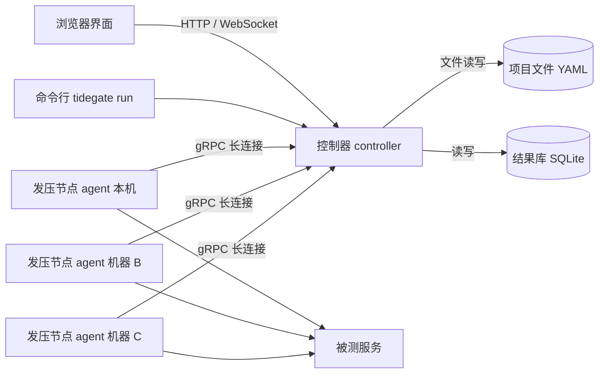

# Tidegate 产品规划与功能设计

版本：v0.1 草案　日期：2026-11-10

## 1. 一句话定位

Tidegate 是一个本地优先的 API 管理与压测一体化工具：在同一个界面里管理接口、调试接口、编排场景，然后直接发起单机或多机集群压测，并实时看到图表和发压机自身的带宽占用。

目标是把接口管理的易用性和专业压测工具的场景能力、发压能力合在一个工具里，同时解决这类工具常见的问题：界面卡顿、发压性能不足、看不到发压机瓶颈。

## 2. 要解决的问题

| 现有痛点 | 原因 | Tidegate 的做法 |
|---|---|---|
| 压测工具界面卡、吃内存 | 一个虚拟用户占一个线程，界面和发压在同一个进程里 | 界面和发压引擎分成两个进程，引擎用 Go 协程 |
| 接口管理工具自带的压测性能弱、压测时卡住 | 请求由界面进程用脚本发出，界面实时渲染每条结果 | 引擎只上报每秒聚合后的指标，界面不处理单条请求 |
| 接口管理和压测要用两个工具 | 高性能的压测工具大多只有命令行 | 接口定义是唯一数据源，调试、场景、压测都引用它 |
| 不知道压测上限是被测服务还是发压机 | 常见工具只给出发送速率的数字，不和带宽上限比较，也不告警 | 实时显示每台发压机的带宽占用比例、CPU、端口等，饱和时告警并标记结果 |
| 单机上行带宽不够 | 单机发压有物理上限 | 内置分布式集群，多机合并发压 |
| 云同步类客户端的安全风险 | 客户端从云端加载代码和数据 | 自己部署，不需要云端账号，不加载任何远程代码，使用本地账户登录 |

## 3. 设计原则

1. **性能优先**。任何功能如果会拖慢发压热路径，默认关闭，并在界面上标明代价。
2. **界面永不参与发压**。界面只做配置和展示，引擎独立进程运行。
3. **单机就是只有一个节点的集群**。本地压测和集群压测走同一套协议和代码路径，分布式不是后补的功能。
4. **发压机必须可观测**。结果里始终带着发压机的健康数据，发压机饱和时结果要被标记为不可信。
5. **本地优先**。数据是本地的文本文件，可以用 Git 管理，不依赖云端。
6. **数据可进可出**。自有格式完整导入导出，第三方格式导入时给出明确的转换报告。

## 4. 不做什么

- 不做浏览器 UI 自动化和页面录制回放。
- 不做云端 SaaS、账号体系和实时多人协作，团队协作靠 Git。
- 第一阶段不做 Mock 服务和接口文档站点发布，后续视需要再加。

## 5. 总体架构

一个 Go 可执行文件，三种运行方式：

| 命令 | 角色 | 说明 |
|---|---|---|
| `tidegate` | 控制器 + 界面 + 本机发压节点 | 双击或直接运行，自动打开浏览器界面，并启动一个本机 agent 子进程 |
| `tidegate agent --join <地址>` | 发压节点 | 在其他机器上运行，主动连接控制器 |
| `tidegate run <场景文件>` | 无界面压测 | 用于 CI 或服务器环境，输出报告文件 |

关键决定：

- **界面形态**（已确认）：浏览器 Web 界面，前端资源编译进可执行文件，由控制器提供。原生程序默认只监听 `127.0.0.1`，对外访问必须启用 TLS 并登录。
- **部署方式**（已确认）：原生可执行文件和 Docker 镜像都提供。Linux 上的发压节点推荐用 Docker 加 host 网络；Windows 上的发压节点用原生程序，不用 Docker Desktop。
- **节点主动连控制器**：agent 向控制器发起连接，发压机在内网或 NAT 后面也能加入集群。
- **本机压测也走 agent 子进程**：界面进程的任何卡顿都不会影响发压，发压把 CPU 打满也不会让界面失去响应。

## 6. 功能设计

优先级：P0 是第一个可用版本必须有的，P1 是完整版，P2 是后续增强。

### 6.1 接口管理

| 功能 | 说明 | 优先级 |
|---|---|---|
| 项目与目录树 | 项目、多级目录、接口，支持拖拽排序、复制、搜索 | P0 |
| 接口定义 | 方法、URL、路径参数、查询参数、请求头、请求体（JSON、表单、multipart、原始数据、二进制文件） | P0 |
| 环境 | 多环境切换（开发、测试、生产），每个环境有独立的基础地址和变量 | P0 |
| 变量 | 全局、环境、场景、临时四级变量，`{{name}}` 引用，内置随机数、时间戳、UUID 等函数 | P0 |
| 鉴权 | Basic、Bearer Token、API Key、OAuth 2.0 客户端模式，支持目录级继承 | P0 |
| 单次调试 | 发送一次请求，查看响应体、响应头、状态码、各阶段耗时（DNS、建连、TLS、首字节、下载） | P0 |
| 提取器 | 从响应里用 JSONPath、正则、响应头、XPath 提取值存入变量 | P0 |
| 断言 | 状态码、响应时间、响应体包含、JSONPath 取值比较、JSON Schema 校验 | P0 |
| 调试历史 | 保留最近的调试请求和响应 | P1 |
| 响应示例与字段说明 | 保存响应示例、字段描述，用于导出 OpenAPI | P1 |
| 敏感变量 | 密钥类变量单独存放在项目目录之外，不进入 Git，不随项目导出 | P1 |

### 6.2 场景编排

场景是一组有顺序的步骤，直接引用接口库里的接口，接口改了场景自动跟着变。

| 功能 | 说明 | 优先级 |
|---|---|---|
| 步骤引用接口 | 引用接口并可以在步骤里覆盖参数 | P0 |
| 单接口一键压测 | 在接口页面直接点“压测”，自动生成只有一个步骤的场景 | P0 |
| 思考时间 | 固定、随机范围、正态分布的等待 | P0 |
| 数据驱动 | CSV、JSON 数据文件，支持顺序、随机、每个虚拟用户唯一三种取值方式 | P0 |
| 流程控制 | 循环、条件分支、按权重随机分支、分组（事务） | P1 |
| 多场景混合 | 一次压测里同时跑多个场景，各自设置流量占比 | P1 |
| 脚本步骤 | 用 JavaScript 写前置和后置逻辑，界面上标明会降低发压性能 | P2 |

### 6.3 压测配置

| 功能 | 说明 | 优先级 |
|---|---|---|
| 并发模式（闭环） | 固定虚拟用户数，每个用户收到响应后再发下一个请求 | P0 |
| 速率模式（开环） | 固定每秒请求数，不受响应快慢影响，避免延迟统计失真 | P0 |
| 阶段编排 | 多个阶段组合：预热、爬坡、保持、下降，图形化预览负载曲线 | P0 |
| 停止条件 | 按时长、总请求数、手动停止 | P0 |
| 阈值 | 设置通过标准，例如 P95 小于 200 毫秒、错误率小于 1%；可配置不达标时自动中止 | P1 |
| 压测中调整 | 运行过程中在界面上调高或调低并发和速率 | P1 |
| 连接选项 | 长连接开关、连接池大小、超时、重定向、HTTP 版本、TLS 校验、代理、DNS 覆盖 | P0 |
| 预估检查 | 开压前根据请求大小和目标速率估算所需带宽和节点数，不够时给出提示 | P1 |

### 6.4 实时图表与报告

界面每秒刷新一次，数据是引擎聚合后的结果。

| 图表 | 内容 | 优先级 |
|---|---|---|
| 吞吐量 | 每秒请求数，成功和失败分开 | P0 |
| 响应时间 | P50、P90、P95、P99、最大值随时间变化 | P0 |
| 错误 | 错误率曲线，按状态码和错误类型分组的明细 | P0 |
| 并发 | 活跃虚拟用户数、活跃连接数 | P0 |
| 带宽 | 上行和下行速率，见 6.5 | P0 |
| 按接口拆分 | 每个接口各自的吞吐量、延迟、错误率表格和曲线 | P0 |
| 延迟分布 | 直方图和热力图 | P1 |
| 耗时分解 | DNS、建连、TLS、首字节、下载各阶段占比 | P1 |
| 节点视图 | 每台发压机各自的指标 | P1 |

报告：

| 功能 | 说明 | 优先级 |
|---|---|---|
| 历史记录 | 每次压测自动保存，可以回看全部图表 | P0 |
| 错误采样 | 保存一部分失败请求和慢请求的完整请求与响应，用于排查 | P0 |
| 独立 HTML 报告 | 导出单个 HTML 文件，离线可打开 | P1 |
| 多次对比 | 选两次或多次压测叠加对比，可设基线 | P1 |
| 指标外发 | 实时写入 Prometheus、InfluxDB | P2 |

### 6.5 发压机带宽与瓶颈监控

这是 Tidegate 的主要特点：不只给出发送速率的数字，还把它和带宽上限做比较，实时告警，并标记结果是否可信。

**采集两层数据：**

| 层 | 采集方式 | 作用 |
|---|---|---|
| 应用层流量 | 在引擎的连接上统计实际读写的字节数，包含请求头和 TLS 加密后的数据 | 精确知道本次压测产生了多少流量，可以拆分到每个接口 |
| 网卡层流量 | 读取操作系统的网卡计数器和网卡协商速率 | 知道网卡的真实负载，包括 TCP/IP 头和机器上其他程序的流量 |

**界面展示：**

- 每台发压机的上行、下行速率曲线，单位 Mbps。
- 带宽占用百分比。上限来源有两个：网卡协商速率（自动读取）和用户手填的实际可用带宽（例如云服务器限速 100 Mbps）。
- 集群总带宽。

**发压机健康指标与告警：**

| 指标 | 告警条件（默认值，可调） |
|---|---|
| 上行带宽占用 | 超过 80% |
| CPU 占用 | 超过 85% |
| 内存占用 | 超过 85% |
| 可用临时端口 | 剩余不足 10% |
| TCP 重传率 | 明显升高 |
| 调度延迟 | 速率模式下实际发出的请求数达不到目标值 |

触发告警时，界面顶部显示“发压机已成为瓶颈，本次结果可能低估了被测服务的能力”，并在图表的对应时间段做标记，报告里同样保留这个标记。

**其他能力：**

- 每个节点可以设置带宽上限，避免压测占满生产网络出口。（P1）
- 开压前的带宽预估，见 6.3。（P1）
- 说明：网卡计数器只能反映本机网卡，测不到上游路由器或运营商的限速，所以保留用户手填上限的方式。

### 6.6 分布式集群

| 功能 | 说明 | 优先级 |
|---|---|---|
| 节点加入 | 在其他机器上运行 `tidegate agent --join <控制器地址> --token <令牌>` | P1 |
| 节点列表 | 界面显示每个节点的系统、CPU 核数、内存、网卡速率、在线状态 | P1 |
| 负载分配 | 按权重把并发或速率分给各节点，默认按 CPU 核数，可手动调整 | P1 |
| 场景和数据下发 | 控制器把场景和数据文件发给各节点；CSV 可以按节点切片，保证数据不重复使用 | P1 |
| 同步启动 | 各节点对时后在同一时刻开始，阶段切换保持一致 | P1 |
| 指标合并 | 各节点上报延迟直方图，控制器合并直方图后再计算百分位，不对百分位做平均 | P1 |
| 节点故障处理 | 节点掉线时在图表上标记，可选择把它的负载重新分给其他节点或直接中止 | P1 |
| 通信安全 | 节点和控制器之间使用 TLS 加密，凭令牌加入 | P1 |
| 节点标签 | 按地域、机房打标签，压测时选择用哪些节点 | P2 |
| 容器部署 | 提供 Docker 镜像和 Kubernetes 部署示例 | P2 |

单机版本从一开始就用同一套 agent 协议，所以集群功能主要是增加节点管理和负载分配，引擎不需要重写。

### 6.7 导入导出

**自有格式（完整往返）：**

- 项目就是一个目录，里面是 YAML 文本文件，一个接口一个文件，可以直接用 Git 管理和代码评审。
- 整个项目可以打包成单个 `.tidegate` 文件（zip 压缩包）导出，导入后完全一致，包括接口、环境、场景、数据文件、压测配置。
- 压测结果可以单独导出和导入，方便把结果发给别人查看。

**第三方格式：**

| 格式 | 导入 | 导出 | 优先级 |
|---|---|---|---|
| OpenAPI 3.x / Swagger 2.0 | 支持 | 支持 | P0 |
| cURL 命令 | 支持 | 支持 | P0 |
| Postman Collection v2.1（含环境文件） | 支持 | 支持 | P1 |
| HAR | 支持 | 支持（错误采样可导出为 HAR） | P1 |
| JMeter `.jmx` | 支持常用元件 | 不做 | P1 |
| Apifox 导出文件 | 支持 | 不做 | P1 |
| k6 脚本 | 不做 | 支持（把场景导出为 k6 脚本） | P2 |

**结果数据：**

| 格式 | 说明 | 优先级 |
|---|---|---|
| CSV / JSON | 每秒聚合指标 | P0 |
| JMeter JTL | 兼容现有的 JMeter 报告工具 | P2 |
| HTML 报告 | 见 6.4 | P1 |

**关于“完整”的说明：** 第三方格式之间的概念并不一一对应，例如 JMeter 的 BeanShell 脚本、Postman 的测试脚本没法自动转换。每次导入都会生成一份转换报告，列出哪些内容已转换、哪些被跳过、哪些需要手动处理，不会静默丢弃。

JMeter 导入第一批支持的元件：线程组、HTTP 请求、HTTP 请求默认值、HTTP 信息头管理器、CSV 数据文件设置、用户定义的变量、正则和 JSON 提取器、响应断言、固定和随机定时器。

### 6.8 协议支持

| 协议 | 优先级 |
|---|---|
| HTTP/1.1、HTTPS | P0 |
| HTTP/2 | P1 |
| WebSocket | P1 |
| gRPC | P1 |
| SSE | P2 |
| TCP / UDP 原始报文 | P2 |
| HTTP/3、MQTT | P2 |

### 6.9 命令行与 CI

| 功能 | 说明 | 优先级 |
|---|---|---|
| `tidegate run` | 无界面运行场景，终端显示实时摘要 | P1 |
| 退出码 | 阈值不达标时返回非零，CI 可以据此判定失败 | P1 |
| 报告输出 | 指定输出 HTML、JSON、CSV 文件 | P1 |

## 7. 性能设计

### 7.1 引擎做法

- 每个虚拟用户一个 Go 协程，内存占用是千字节级别，不是线程的兆字节级别。
- 场景在开压前编译成执行计划，变量模板预先解析，运行时不解释脚本、不做反射。
- 请求和响应缓冲区复用，响应体默认只读取不保存，只有需要提取或断言时才解析。
- 延迟用 HDR 直方图记录，每个工作协程独立记录，每秒合并一次，热路径上没有锁竞争。
- 默认不保存单条请求记录，只保存每秒聚合数据和错误、慢请求的采样。
- 速率模式按计划发送时间计算延迟，避免服务变慢时延迟被低估（协调遗漏问题）。
- HTTP 客户端先用标准库并调优连接池；里程碑 M0 用基准测试决定是否要换成自研的 HTTP/1.1 客户端。

### 7.2 性能目标

以下是目标值，需要在 M0 阶段实测验证，目前都没有测过。测试条件：8 核机器，被测服务是本机的简单 HTTP 接口，长连接。

| 指标 | 目标 |
|---|---|
| 单机吞吐量 | 每秒 10 万请求以上 |
| 1 万虚拟用户的内存占用 | 低于 500 MB |
| 界面响应 | 压测满载时界面操作无明显卡顿 |
| 界面刷新 | 每秒一次，数据延迟不超过 2 秒 |

M0 会用同一台机器、同一个被测服务做基准测试。如果达不到目标，先调整引擎，再做后面的功能。

## 8. 安全设计

- **不加载远程代码**：界面资源全部编译进可执行文件，设置严格的内容安全策略，不接入统计脚本，不联网，不做遥测。
- **本地账户**：首次启动用一次性初始化码创建管理员；密码只存 Argon2id 哈希；登录限速；会话 Cookie 设置 `HttpOnly` 和 `SameSite=Strict`。
- **传输加密**：本机访问允许明文，其他机器访问必须有 TLS（自带证书、自签名或反向代理）。
- **节点认证**：节点凭加入令牌换取证书，和控制器之间用双向 TLS；节点只执行声明式场景，不执行任意代码。
- **防滥用**：压测目标白名单、按角色的规模上限、审计日志。
- **数据保护**：敏感变量加密存储，不进入导出文件和报告；错误采样里的鉴权请求头自动打码；被测服务返回的 HTML 不直接渲染。
- **供应链**：依赖精简并锁定版本；不做自动更新，发布包提供校验值。
- 脚本步骤（P2）在受限的解释器里运行，不能访问文件系统和执行系统命令，管理员可以全局禁用。

## 9. 技术选型

| 部分 | 选择 | 理由 |
|---|---|---|
| 引擎与控制器 | Go 1.25 或更高 | 协程模型适合高并发发压，单文件分发，跨平台；1.25 起在容器里能自动适配 CPU 限额 |
| 容器 | 单个 Docker 镜像，静态编译，非 root 运行 | 控制器和节点用同一个镜像，启动命令不同 |
| 前端 | React + TypeScript + Vite | 生态成熟，编译后用 `go:embed` 嵌入可执行文件 |
| 图表 | uPlot | 基于 Canvas，时间序列渲染很快，体积小 |
| 界面与控制器通信 | HTTP 接口 + WebSocket 推送 | 简单，浏览器原生支持 |
| 节点与控制器通信 | gRPC 双向流 | 适合长连接和持续上报指标 |
| 项目存储 | YAML 文件 | 可读，可用 Git 管理 |
| 结果存储 | SQLite（纯 Go 实现） | 无需安装数据库，不依赖 C 编译器，Windows 上构建简单 |
| 延迟统计 | HDR 直方图 | 精度高，可以跨节点合并 |
| 脚本（P2） | goja（Go 实现的 JavaScript 解释器） | 不需要外部运行时 |

支持平台：Windows、Linux、macOS。发压节点优先保证 Linux 和 Windows。

## 10. 里程碑

| 里程碑 | 内容 | 验收标准 |
|---|---|---|
| **M0 引擎验证** | 最小发压引擎（HTTP/1.1，并发和速率两种模式，直方图统计），命令行输出结果 | 完成基准测试，达到 7.2 的吞吐量和内存目标 |
| **M1 单机可用版** | 控制器加本机 agent 的进程结构，Web 界面，账户登录与会话，TLS，接口管理 P0，单接口一键压测，实时图表 P0，带宽和发压机健康监控，历史记录，OpenAPI 和 cURL 导入导出，Docker 镜像 | 可以完成单接口和简单多步骤压测，压测时界面不卡；原生程序和 Docker 两种方式都能启动 |
| **M2 场景与数据完整版** | 流程控制，多场景混合，阈值，压测中调整，HTML 报告，多次对比，Postman、HAR、JMeter、Apifox 导入，命令行与 CI，角色、访问令牌、审计日志、压测目标白名单、敏感变量加密 | 现有的 JMeter 常用脚本可以导入并运行 |
| **M3 分布式集群** | 节点加入与管理，负载分配，数据切片，同步启动，直方图合并，节点视图，故障处理 | 三台机器合并发压，总吞吐量接近三台单机之和，图表合并正确 |
| **M4 协议与扩展** | HTTP/2、WebSocket、gRPC，脚本步骤，指标外发，容器部署 | 按实际需求排序 |

带宽监控放在 M1 而不是等到 M3，因为单机时就需要知道是不是带宽到了上限，这也是决定什么时候加节点的依据。

## 11. 待确认的决定

已确认：界面用浏览器 Web 页面并设计账户登录；支持 Docker 部署；第一批只做 HTTP/1.1 和 HTTPS，其他协议后续支持。

下面几项先按当前选择规划，可以调整：

| 问题 | 当前选择 | 备选 |
|---|---|---|
| 使用范围 | 按“可能多人使用、可能部署到服务器”设计，角色等多人功能排在 M2 | 只有一个人用时，角色和审计可以再往后放 |
| 许可证 | 源码公开，PolyForm Strict 1.0.0：允许非商业使用，商用和分发需要授权 | 无 |
| 界面语言 | 简体中文优先，预留多语言 | 中英文同时做 |
| 项目名 | Tidegate | 可以更换 |

